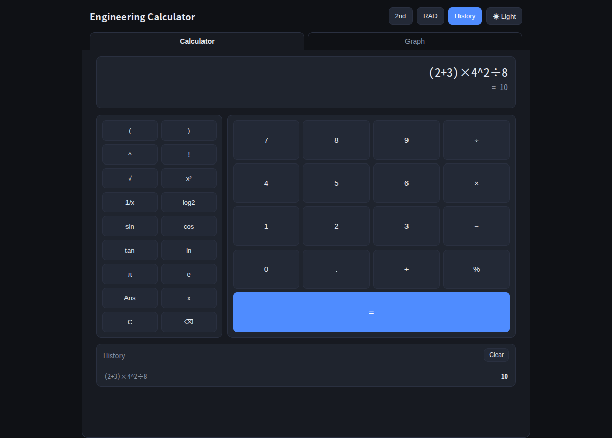
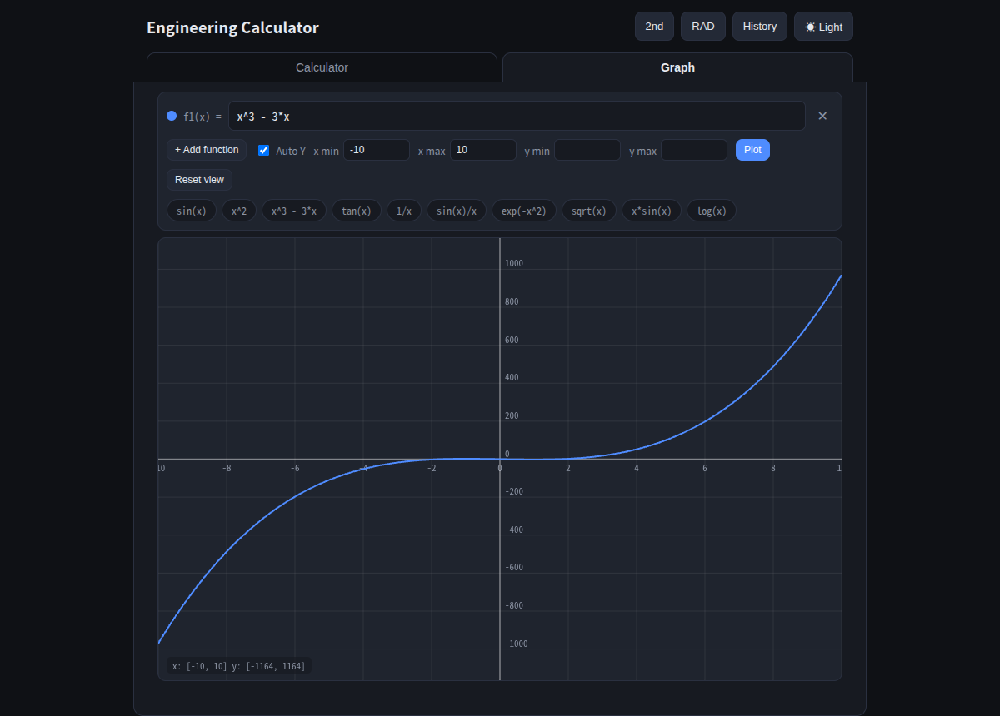
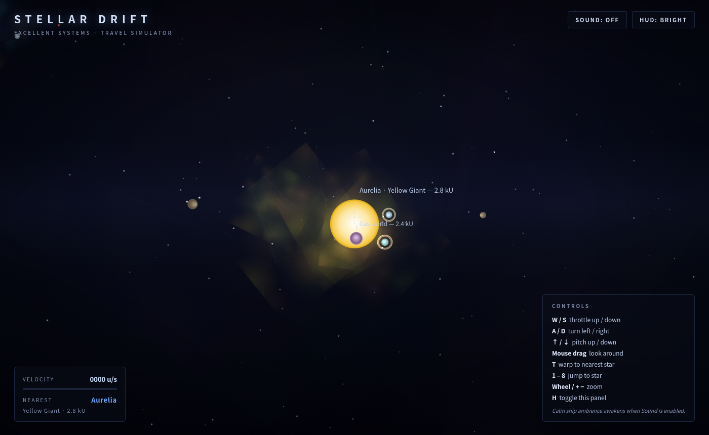
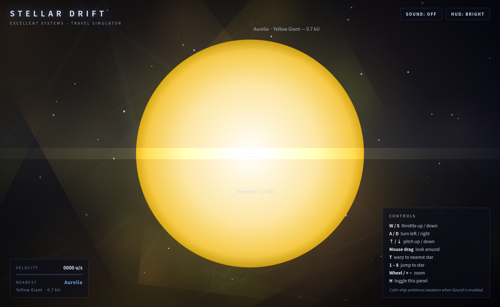
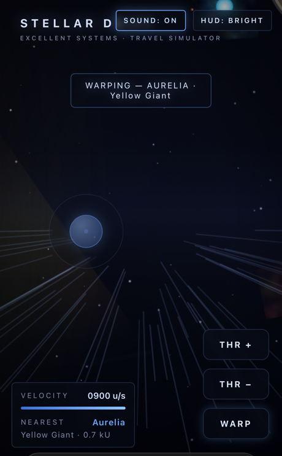
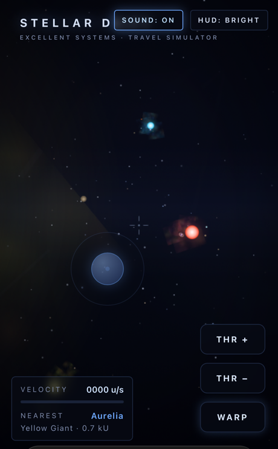
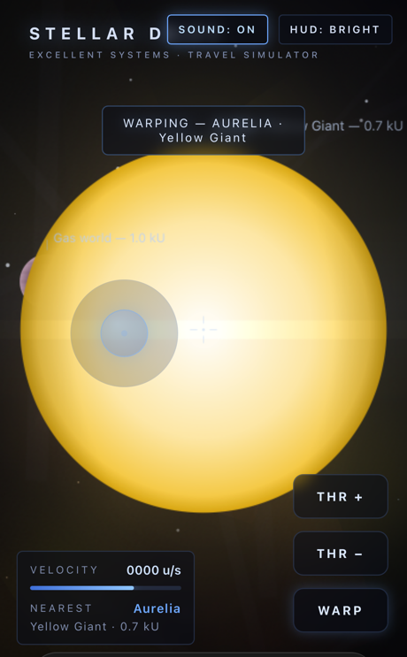

# hermes vibe coding dev setup

Local, on-prem vibe coding with [Hermes Agent](https://hermes-agent.nousresearch.com/) and an open-weight model on your own NVIDIA GPU. You can code from a terminal like Claude Code, or from Telegram with text, photos and voice. Your code and conversations stay on the machine.

The whole setup is one file: [`HERMES_SETUP.md`](HERMES_SETUP.md). A Korean walkthrough is on the [blog](https://daddynkidsmakers.blogspot.com/2026/11/blog-post.html). Hand it to Claude Code or Codex on a new machine and the agent builds the environment from scratch. The file also picks vLLM settings to match the machine's memory (64 GB, 96 GB GPU, or 128 GB unified memory like DGX Spark).

## What you get

| Piece | Choice |
|---|---|
| Model | Qwen3.8-27B NVFP4 on vLLM 0.27.1, plus a DSpark draft model for speculative decoding |
| Fallback | Ollama `qwen3.8:27b-mtp-q4_K_M` (Hermes switches over automatically if vLLM is down) |
| Agent | Hermes Agent, tuned for coding (details below) |
| Telegram bot | same agent; accepts text, photos and voice notes; answers are streamed live and can also be spoken |
| Speech | faster-whisper large-v3-turbo for speech-to-text; MeloTTS on CPU for text-to-speech; both offline |

The coding tuning:
- three tools for coding: terminal, file and todo; the Telegram bot adds web search and text-to-speech, since it also answers questions
- memory off
- a 7-step engineering procedure in SOUL.md: explore, plan, test first, implement, verify, review, report
- a test-gate hook that runs the tests before the agent may finish
- an approval hook that asks before any package install
- reasoning effort pinned to `xhigh`

## Results

The same 9 coding tasks went to Claude Code and to Hermes. The tasks range from a single-file module to fixing a 7-module package. They are scored by 119 hidden tests and live in `bench/`.

| Setup | Tasks fully solved | Hidden-test pass rate | Time |
|---|---|---|---|
| Claude Code (cloud) | 9/9 | 100% | 13 min |
| Hermes, untuned (qwen3-coder 30B) | 1/9 | 56% | n/a |
| Hermes tuned + Qwen3.8 27B on Ollama | 9/9 | 100% | 89.5 min |
| Hermes tuned + Qwen3.8 27B NVFP4 on vLLM + DSpark (this repo) | 9/9 | 100% | 48.0 min |

Other local models tried with the same tuning:
- laguna-xs-2.1 33B-A3B: 98%
- qwen3.5 122B-A10B: 96%
- qwen3-coder-next 80B-A3B: 94%
- qwen3.6 35B-A3B: 91%

On these tasks accuracy matched Claude Code. Hermes is about 3 to 4 times slower, and it is weaker at catching visual and UI mistakes on its own. Large codebases, multi-hour tasks and vague requirements were not measured.

Inference speed on one RTX PRO 6000 Blackwell (96 GB), 10K-token prompt:

| Engine | Prefill | Generation, code | 9 tasks |
|---|---|---|---|
| Ollama q4 + MTP | 554 tok/s | ~75 tok/s | 89.5 min |
| vLLM NVFP4 + MTP | 7,695 tok/s | 152 tok/s | 58.5 min |
| vLLM NVFP4 + DSpark draft | 7,304 tok/s | 246 tok/s | 48.0 min |

Prefill matters most for an agent because Hermes resends the whole conversation on every tool call.

## Why use it anyway

It is slower than Claude Code or Codex. It is still worth running.

- **Your code never leaves the machine.** Source code, logs, customer data, screenshots and voice notes are handled on your own GPU. For defense, finance, healthcare, public-sector or any NDA-bound work, this is often the difference between having an AI coding agent and having none.
- **It works air-gapped.** After the one-time model download, everything runs without the internet, apart from relaying Telegram messages. Copy the models and this repo into a closed network and set it up there.
- **No usage meter.** There are no per-token charges, rate limits or weekly caps. Leave it running overnight on long tasks, run many experiments, or let a whole team share one GPU server. The cost is the hardware and electricity you already pay for.
- **Same answers on the measured tasks.** On the 9-task benchmark it solved everything Claude Code solved. The gap is speed, not correctness, and speed improves with hardware and better draft models.
- **You control the stack.** The model version is pinned, so behavior does not change under you. Prompts, tools, hooks and policies are plain files you can audit and edit. No vendor outage, policy change or price change can stop your work.
- **Swap in better models as they appear.** Open-weight models have trailed the frontier by roughly 6 to 12 months and keep closing the gap. Replace the model, rerun `bench/`, and keep everything else.
- **Code from anywhere.** Through Telegram you can send a task by text, photo or voice from your phone and get the result back while you are away from the desk.

Use it where privacy, cost or control matters more than raw speed. For the hardest, largest or most ambiguous work, a frontier cloud agent is still faster.

## Install with Claude Code or Codex

On the new machine:

```bash
git clone https://github.com/mac999/hermes_vibe_dev.git
cd hermes_vibe_dev
```

Then start your coding agent in that folder with this prompt:

```bash
claude "Read HERMES_SETUP.md and set up this machine by following it section by section. Follow section 0 exactly: ask me before sudo, GPU choice or deleting anything, and never ask me for the Telegram token in chat."
```

```bash
codex "Read HERMES_SETUP.md and set up this machine by following it section by section. Follow section 0 exactly: ask me before sudo, GPU choice or deleting anything, and never ask me for the Telegram token in chat."
```

The agent will:
1. ask for the GPU, the bot's working folder, and whether you want Telegram and voice
2. write the 18 kit scripts embedded in the file to `~/hermes-coder-kit`
3. detect the memory tier
4. install vLLM, download the models (about 26 GB, checked with sha256), and install Ollama, Hermes and the profiles
5. report a filled-in checklist

The Telegram token is the one step you do yourself:
```bash
bash ~/hermes-coder-kit/telegram/setup-telegram.sh
```
The script reads the token hidden, checks it with Telegram, and stores it with mode 600.

You can also follow `HERMES_SETUP.md` by hand. Every step has the command and the expected output.

A step-by-step walkthrough in Korean, covering hardware, prerequisites, installation and tuning, is on the blog: [헤르메스 기반 바이브 코딩 환경 설치 및 최적화 방법](https://daddynkidsmakers.blogspot.com/2026/11/blog-post.html).

## Memory tiers

`scripts/detect-tier.sh` chooses the settings below. They come from measurements with a 64K-token prompt, which is the worst case for Hermes.

| Tier | Machine | Draft model | KV cache | Peak memory | Code speed* |
|---|---|---|---|---|---|
| `gpu96` | dedicated GPU >= 90 GB | DSpark | 12 GiB | ~77 GB | ~246 tok/s |
| `unified128` | 128 GB unified memory (DGX Spark / GB10) | DSpark | 8 GiB | ~76 GB | lower (bandwidth bound) |
| `mem64` | 48 to 110 GB, including 80 GB GPUs | none | 5 GiB | ~30 GB | ~58 tok/s |
| `small` | under 48 GB | no vLLM; Ollama only | - | ~22 GB | ~75 tok/s |

\* Speed measured on the reference GPU. A DGX Spark has roughly one sixth of its memory bandwidth, so generation there is correspondingly slower.

Why the draft model needs so much memory: with speculative decoding on, vLLM 0.27.1 crashes if it splits a long prompt into chunks. So the prompt has to be prefilled in one 64K chunk, which takes about 16 GiB of activations. Without the draft model, 8K chunks are safe.

The KV cache itself is small, because only 16 of Qwen3.8's 64 layers use full attention. 5 GiB already holds about 142K tokens.

On unified memory the model shares RAM with the OS, Hermes and the speech models. That is why that tier uses a smaller KV cache and fewer concurrent requests.

The `unified128` and `mem64` values were derived from runs on the reference GPU, not on those machines. Section 10 of `HERMES_SETUP.md` has the check to run there.

## Showcase: built entirely over Telegram

Both apps were built by Hermes running Qwen3.8 27B locally. All requests were sent from a phone through the Telegram bot; nothing went to a cloud model. Prompts are shown as sent, in Korean, with an English translation.

### Engineering calculator (Flask web app)

> 좋아. 그럼 웹뷰 기반 공학용 계산기 개발해. 다크모드 지원. 영어 ux기반. 함수 그래프 출력 지원.
>
> *Build a web-view engineering calculator. Dark mode, English UX, function graph plotting.*

Hermes planned the work with its todo tool, then wrote tests first: 5 pytest tests and 11 node tests for the expression evaluator. It built the Flask app and verified it, in about 10 minutes and 29 model calls.

The first version passed all its tests but had no `+` key on the keypad. Its tests covered the evaluator, not the layout. One follow-up message fixed it:

> 더하기 버튼 추가후 개선. 재실행
>
> *Add the plus button, polish, and restart.*

| Calculator | Function graph |
|---|---|
|  |  |

It covers operator precedence, `2pi`-style implicit multiplication, RAD/DEG, `2nd` functions, `Ans`, history, a light/dark toggle and multi-function plotting with presets.

### Stellar Drift: star-system travel simulator

> 이제 우수 항성계를 여행하는 시뮬레이터 개발. 파이썬 플라스크 기반 웹뷰 앱. 다크모드. 영문. 성운. 거대 항성. 아름다운 성운과 화려한 이팩트. 잔잔한 우주선 음향. 테스트 후 링크줘.
>
> *Build a simulator for traveling between star systems. Python Flask web-view app. Dark mode, English. Nebulae, giant stars, beautiful nebulae and flashy effects, a calm starship ambience. Test it, then send me the link.*

> 3d 일인칭 시점 뷰. 아이폰에서도 실행 가능하게 적절히 뷰 처리.
>
> *First-person 3D view. Make the view work on an iPhone too.*

Hermes split the work as follows:
- `spacecore.js`: pure logic with node tests (catalog, orbits, throttle, warp)
- a canvas renderer for the starfield, nebulae, giant stars, planets and particles
- a procedural Web Audio ambience
- an iPhone layout with a virtual joystick, throttle and WARP buttons

It then checked the result in headless Chrome, both as a desktop and as an emulated iPhone.

| Desktop | Warp arrival |
|---|---|
|  |  |

On an iPhone over the local network:

| Warping | Cruising | Arrived at a yellow giant |
|---|---|---|
|  |  |  |

The full source is in [`coding_example/stellar_drift`](coding_example/stellar_drift), with install and run steps.

There is still room for polish, and the local model's weakness is visible here. On a narrow phone screen the title runs under the SOUND button, and the WARPING banner stays on screen after arrival. Sending such a screenshot back to the bot with "fix these" usually works now that the model reads images natively.

## Repository layout

```
HERMES_SETUP.md   the setup file: instructions plus every script, for an agent or a person
bench/            9 coding tasks with hidden tests, runner, scorer, speed tools (see bench/README.md);
                  task prompts are in Korean, as used for the measurements
results/          benchmark summaries from the reference machine
images/           screenshots used above
coding_example/   Stellar Drift, the game Hermes built over Telegram, ready to run
```

## Tips

- Start each new task in Telegram with `/new`. Long chats trigger context compression and slow every call.
- Write requirements explicitly: names, formats, error handling, what must not change. Most misses were unstated requirements.
- For anything with a UI, ask for a visual check: "verify with verify-webapp and send screenshots".
- `/voice on` answers voice notes with voice; `/voice off` turns it off.

## License

MIT, see [LICENSE](LICENSE). The models and third-party tools keep their own licenses: Qwen3.8 and its NVFP4 build, the DSpark draft, MeloTTS, faster-whisper, vLLM, Ollama and Hermes Agent.
