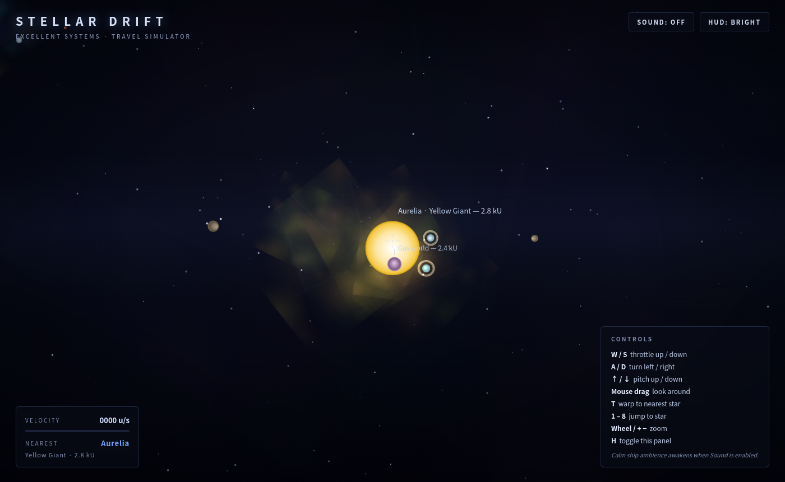

# Stellar Drift

A star-system travel simulator that runs in the browser. You fly past nebulae, giant stars and planets in first person, and you can warp between star systems. A calm, procedurally generated starship ambience plays in the background. Hermes built this app with the local Qwen3.8 27B model. All requests were sent from a phone over Telegram (see the main [README](../../README.md)).



- Backend: Flask. It serves one page and a health endpoint.
- Frontend: plain JavaScript on a 2D canvas, with no external libraries or CDNs.
  - `spacecore.js`: logic for the star catalog, orbits, throttle and warp
  - `scene.js`: the renderer
  - `audio.js`: Web Audio ambience
  - `app.js`: input and HUD
- Works on desktop browsers and on iPhone/Android, with touch controls.

## Requirements

- Python 3.10 or later
- Node.js 18 or later (only for the JavaScript tests)

## Install

```bash
cd coding_example/stellar_drift
python3 -m venv .venv
source .venv/bin/activate
pip install -r requirements.txt
```

## Run

```bash
python app.py
```

Open http://127.0.0.1:5007 in a browser. To play from a phone on the same network, open `http://<this-machine-ip>:5007`. The server listens on all interfaces, so allow port 5007 in the firewall if needed.

Check that the server is up:

```bash
curl http://127.0.0.1:5007/api/health
```

## How to play

1. Click **SOUND: OFF** to turn the ambience on. Browsers only allow audio after a user action.
2. Raise the throttle with **W** (or hold **THR +** on a phone) and look around.
3. Press **T** (or **WARP**) to jump to the nearest star, or **1** to **8** to pick one. The HUD shows velocity, the nearest body and its distance.
4. Press **H** to hide or show the controls panel, and use **HUD: BRIGHT** to dim the overlay.

| Desktop | Touch |
|---|---|
| W / S: throttle up / down | THR + / THR -: hold to throttle |
| A / D: turn left / right | left zone: virtual joystick (turn / pitch) |
| Up / Down arrows: pitch | right zone: drag to look |
| mouse drag: look around | pinch: zoom |
| T: warp to the nearest star; 1 to 8: jump to a star | WARP: jump to the nearest star |
| mouse wheel or + / -: zoom | |

## Test

```bash
pip install pytest
python -m pytest -q tests          # Flask routes and page markers (4 tests)
node --test tests/spacecore.test.mjs   # catalog, orbits, throttle, warp logic (8 tests)
```

## Files

```
app.py                  Flask server, port 5007
templates/index.html    page, HUD and touch controls
static/js/spacecore.js  simulation logic (no DOM), tested with node
static/js/scene.js      canvas renderer: starfield, nebulae, stars, planets, particles
static/js/audio.js      procedural starship ambience (Web Audio)
static/js/app.js        keyboard, mouse and touch input, HUD
static/css/style.css    dark HUD styles, mobile layout
tests/                  pytest and node tests
```

## Known issues

On narrow phone screens the title can run under the SOUND button. The WARPING banner can also stay on screen after arrival. Both are left as Hermes produced them, so the example shows the model's real output.
